# IT Help Desk Ticketing System — Jira Service Management

## Project Overview

This project demonstrates hands-on experience using Jira Service Management to simulate common Tier 1 IT Help Desk responsibilities.

I configured a cloud-based IT service project and managed three simulated support incidents from ticket creation through resolution. The project focuses on incident tracking, prioritization, ticket assignment, troubleshooting documentation, and service desk workflows.

**Platform:** Jira Service Management  
**Project Type:** IT Support / Incident Management  
**Environment:** Cloud-Based Help Desk Lab

## Project Objectives

- Create and manage IT support tickets using Jira Service Management.
- Assign incidents and track ticket progress.
- Categorize issues by priority, urgency, and impact.
- Document troubleshooting procedures using internal notes.
- Practice resolving and closing support incidents.
- Develop familiarity with enterprise IT service management workflows.

## Support Incidents

### Incident 1 — Windows Account Lockout (IT-1)

**Problem:** An employee was unable to log in to a Windows workstation following multiple unsuccessful authentication attempts.

**Troubleshooting Plan:** Verify user identity, check account lockout status in Active Directory, investigate failed login attempts, and restore access when authorized.

**Simulated Resolution:** The account was unlocked, and workstation access was restored.

### Incident 2 — Wi-Fi Connectivity Issue (IT-2)

**Problem:** An employee's Windows laptop could not connect to the company wireless network.

**Troubleshooting Plan:** Inspect wireless adapter settings, check network configuration using `ipconfig /all`, test connectivity with `ping`, and investigate DNS using `nslookup`.

**Simulated Resolution:** The saved wireless network profile was recreated, restoring connectivity.

### Incident 3 — Network Printer Issue (IT-3)

**Problem:** An employee could not print documents because the network printer appeared offline and print jobs remained queued.

**Troubleshooting Plan:** Check printer connectivity, inspect the Windows print queue, evaluate the Print Spooler service, and verify printer drivers.

**Simulated Resolution:** The print queue was cleared and the Print Spooler service was restarted.

## Ticket Management Workflow

1. Create an incident ticket.
2. Record the reported issue and affected services.
3. Set urgency, impact, and priority.
4. Assign the ticket to a technician.
5. Move the ticket to Work in Progress.
6. Document troubleshooting steps using internal notes.
7. Record a simulated resolution and close the incident.

## Project Screenshots

#### 1. Jira Project Dashboard
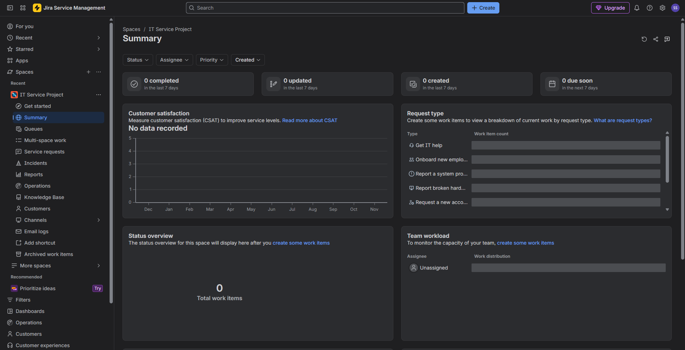

#### 2. Ticket Queue
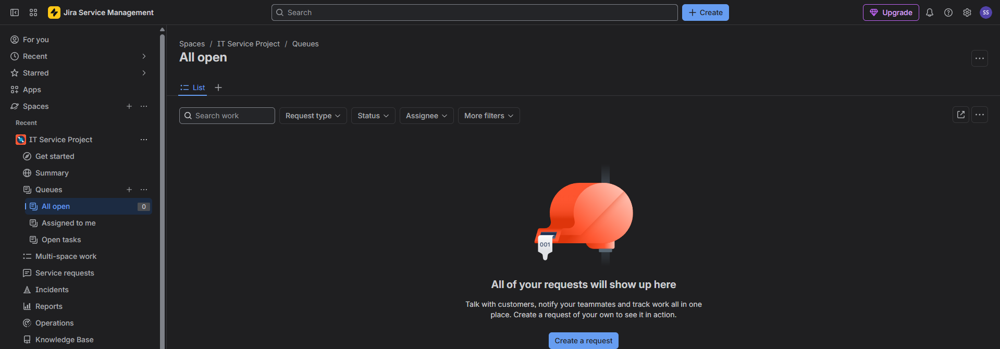

#### 3. Incident Ticket Details
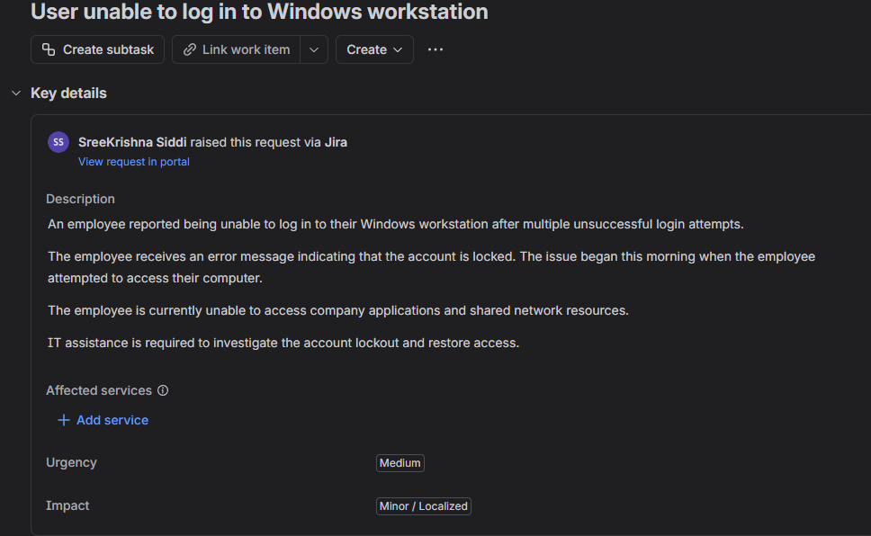

#### 4. Ticket Assignment
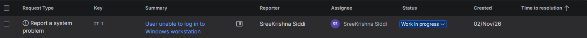

#### 5. Windows Account Troubleshooting
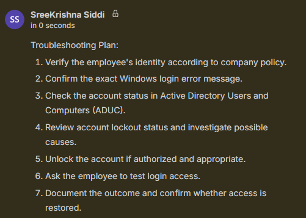

#### 6. Windows Incident Resolution
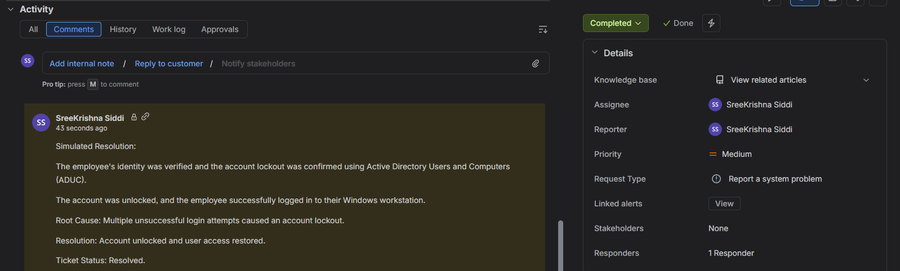

#### 7. Network Connectivity Incident
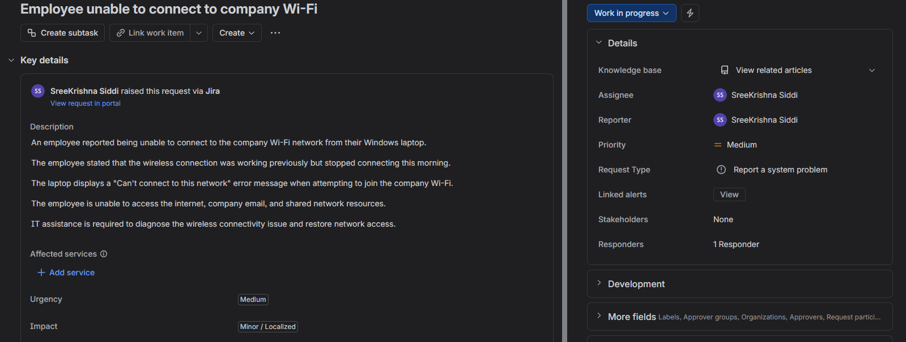

#### 8. Network Troubleshooting
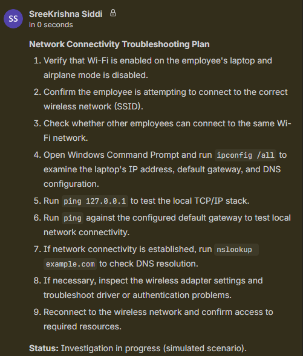

#### 9. Network Incident Resolution
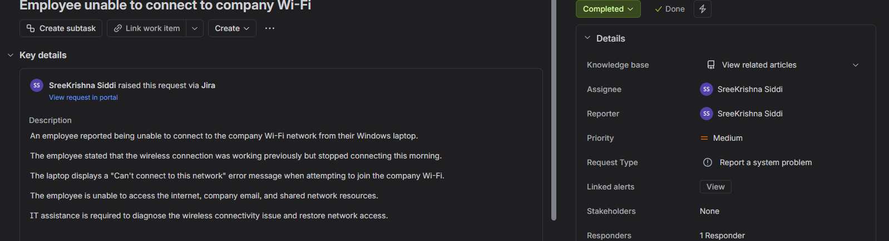

#### 10. Printer Incident

#### 11. Printer Troubleshooting
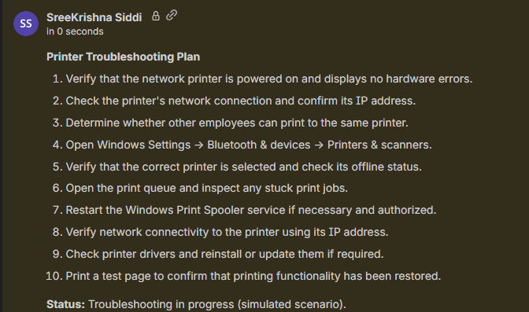

#### 12. Printer Resolution
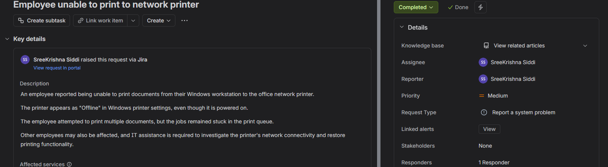

#### 13. Completed Tickets Overview
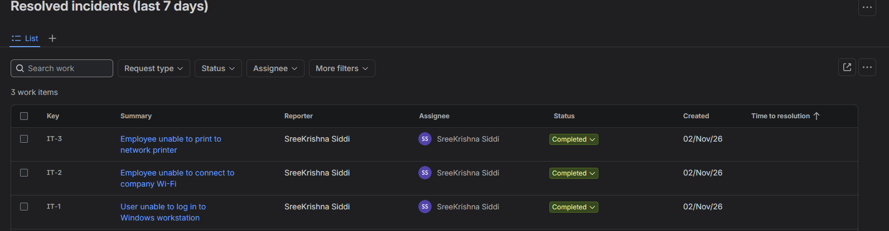

## Skills Demonstrated

- Jira Service Management
- IT Incident Management
- Help Desk Ticketing Systems
- Ticket Prioritization and Assignment
- IT Support Documentation
- Windows Account Troubleshooting Concepts
- Basic Network Troubleshooting Concepts
- Printer Troubleshooting Concepts
- Incident Resolution Workflow

## Project Outcome

Successfully created, assigned, tracked, and completed three simulated IT support incidents in Jira Service Management.

All technical resolutions were documented as simulated scenarios rather than verified changes to production systems. The project demonstrates practical Jira ticket management and familiarity with common Tier 1 help desk troubleshooting workflows.
